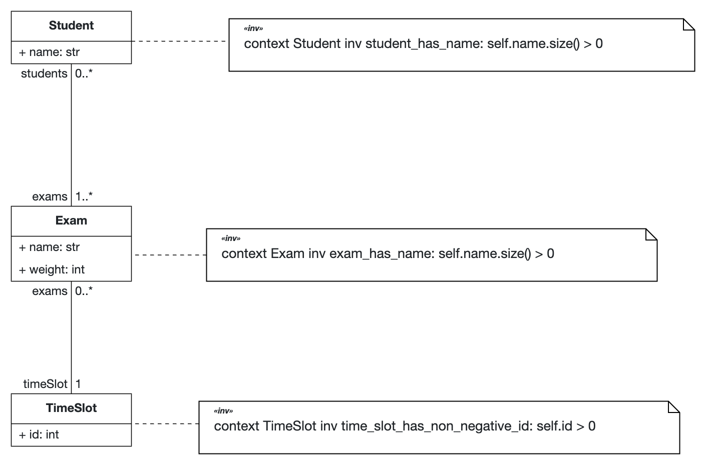
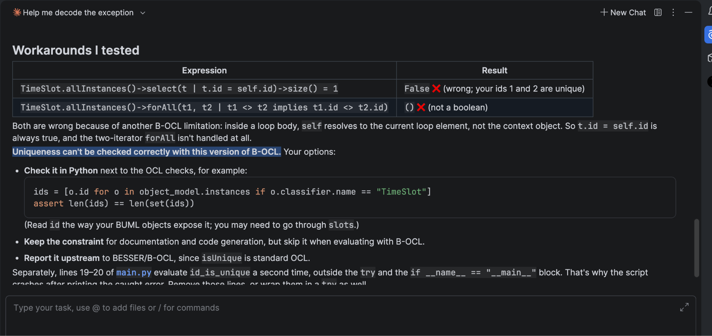
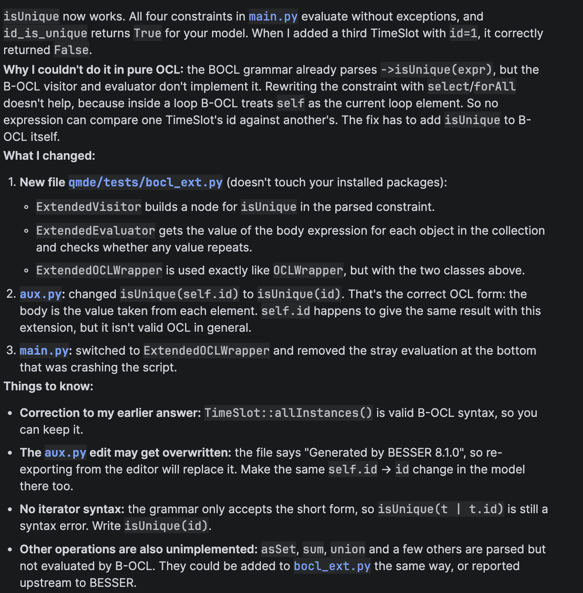
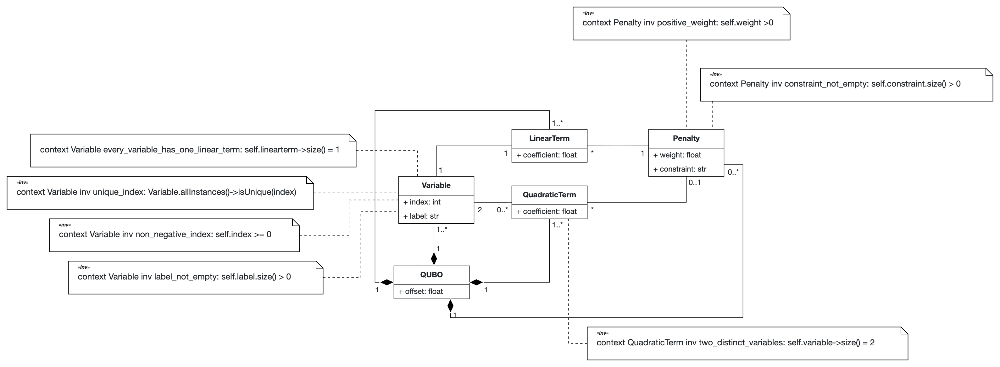
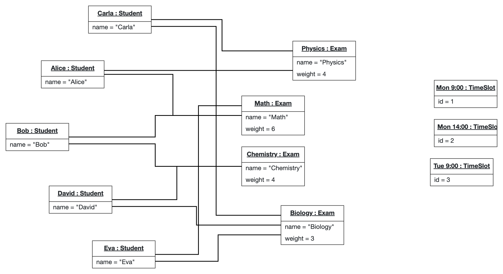
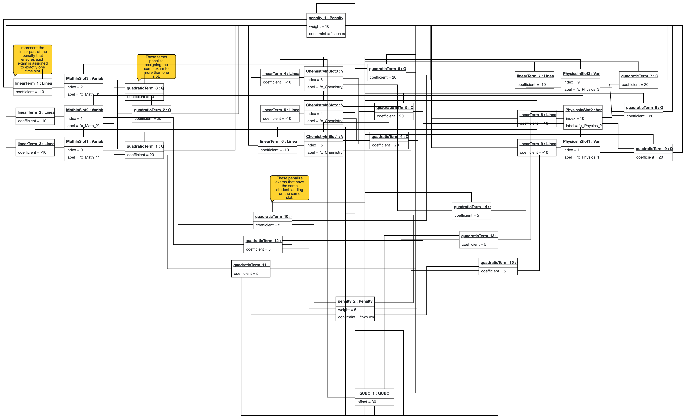

- **Group:** G3
- **Problem:** A3 (Optimisation with QAOA - Exam-slot assignment)

| \# | Class                                                          | Intermediate model (solution DSL) | Quantum algorithm |
|:---|:---------------------------------------------------------------|:----------------------------------|:------------------|
| A  | Optimisation with QAOA (graph problems, selection, assignment) | QUBO                              | QAOA              |

| \# | Problem (domain of the problem DSL) | Underlying problem                                                      | Complexity · notes                                                                       |
|:---|:------------------------------------|:------------------------------------------------------------------------|:-----------------------------------------------------------------------------------------|
| 3  | Frequency or exam-slot assignment   | Graph colouring with k colours, minimising conflicts (one-hot encoding) | **NP-hard** · k-colourability NP-complete for k ≥ 3; for k \= 2 it is in P, so use k ≥ 3 |

| Layer            | Artefact                                                                                                                                                      | Produced by                                                   |
|:-----------------|:--------------------------------------------------------------------------------------------------------------------------------------------------------------|:--------------------------------------------------------------|
| 1\. Problem DSL  | Abstract syntax (metamodel \+ OCL) for describing problem instances of your class of problems                                                                 | You (Part I)                                                  |
| 2\. Solution DSL | A mathematical formulation of the problem, defined per class in Annex A: QUBO, Boolean formula (CNF), linear integer constraints, or integer linear programme | You (Part I) M2M transformation T1 from Problem DSL (Part II) |

## Explanation of the problem

In the **Exam-Slot Assignment Problem**, a university needs to schedule final exams for a set of courses into a limited number of time slots so that **no student has two exams at the same time**.

As there may be cases with no feasible solution (where no configuration allows every student to take every exam they need), weights are added to each exam to establish priorities and assign a penalty for missing an exam. In these cases, the goal is to minimize the penalties for missed exams (i.e., the lowest possible weights).

## Problem DSL

| Concept  | Intrinsic Properties             | Extrinsic Properties                                                                                        |
|----------|----------------------------------|-------------------------------------------------------------------------------------------------------------|
| Student  | name: String                     | Has to do 0 or more exams.                                                                                  |
| Exam     | name: String  weight: integer | Must have one or more students.  Occupies exactly one time slot (or 0 before being assigned a TimeSlot). |
| TimeSlot | id: int                          | Has 0 or more exams.                                                                                        |

### OCL Constraints

Here I made use of Gemini/Argon(low) to ask for what OCL examples made sense for my model, I gave the model input as codified in plantuml.

* **`Unique TimeSlot IDs:`** `Every time slot must have a distinct identifier.`
* **`Non Negative TimeSlot IDs`**
* **`Unique Exam Names:`** `No two exams should have the exact same course/subject name.`
* **`Non-Empty Attributes:`** `Names and IDs cannot be empty.`

> Uniqueness can't be checked correctly with this version of B-OCL.

This is something I also figured out using AI:

I also used AI to get a workaround working locally which I can show the professor if he is interested:

## Solution DSL

| Concept       | Intrinsic Properties                 | Extrinsic Properties                                                        |
|---------------|--------------------------------------|-----------------------------------------------------------------------------|
| QUBO          | Offset: Real                         | Arbitrary number of variables, linear terms, quadratic terms, and penalties |
| Variable      | Index: Integer   Label: String    |                                                                             |
| LinearTerm    | Coefficient: Real                    | One variable, zero or one penalty                                           |
| QuadraticTerm | Coefficient: Real                    | Two variables, zero or one penalty                                          |
| Penalty       | Weight: Real   Constraint: String | Arbitrary number of terms it generates                                      |

## Example models for one small problem instance

A small department must schedule 3 exams into 3 time slots (Mon 9:00, Mon 14:00, Tue 9:00). Several students sit more than one exam, and no student can sit two exams in the same time slot.

We first attempted 4 exams, but had to reduce the number to 3 (k=3) because the solution model was growing exponentially. It had around 100 objects with 4 exams, but around 30 with only 3.

### Students and exams

| Student | Exams              |
|---------|--------------------|
| Alice   | Math, Physics      |
| Bob     | Physics, Chemistry |
| Carla   | Math               |
| David   | Chemistry          |
| Eva     | Physics            |

### Exam weights

| Exam      | weight |
|-----------|--------|
| Math      | 6      |
| Physics   | 4      |
| Chemistry | 3      |

### Goal

Assign each exam to exactly one of the 3 time slots so that the number of conflicts (pairs of exams sharing a student and placed in the same slot) is minimized, ideally zero.

### Conflict graph (derived from the data)

Two exams are connected if at least one student sits both:
- Physics - Chemistry (Bob)
- Physics - Math (Alice)

The graph-coloring instance has vertices representing exams, edges representing shared students, and colors representing time slots. Since there are 3 time slots, the number of colors is (k=3). This satisfies the condition (k ≥ 3), under which the general graph (k)-colorability decision problem is NP-complete.

### A valid solution

| Exam      | Timeslot  |
|-----------|-----------|
| Math      | Mon 9:00  |
| Physics   | Mon 14:00 |
| Chemistry | Mon 9:00  |

### Problem instance

### Solution instance

## Design decisions

- After first modeling the simplest form of the problem and talking with Professor Jácome, we decided that the models seemed too simple. We added exam weights to increase the problem's complexity; this might be removed later, depending on the problem's future complexity.

## References

- Lucas A (2014) Ising formulations of many NP problems. Front. Physics 2:5. doi: 10.3389/fphy.2014.00005